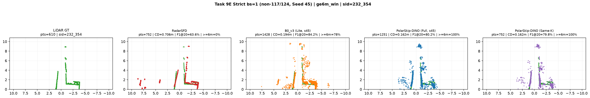
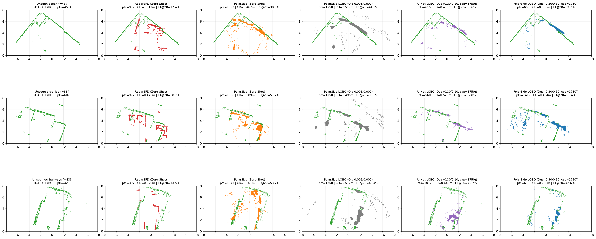

# PolarSkip-DINO

**Real-Time Single-Frame Indoor mmWave Radar Point Cloud Reconstruction with Frozen Visual Backbones and Dual-Tier Readout**

PolarSkip-DINO reconstructs dense, LiDAR-like 2D indoor point clouds from a **single 77 GHz mmWave radar frame** at **38.7 Hz (`25.8 ms`, FP16)** on a single RTX 4090 D GPU.

### Highlights
- **Frozen Visual Backbone + Cartesian Decoding**: Transfers a completely frozen **DINOv3-S/16** encoder into an isotropic metric Cartesian U-Net decoder, avoiding range-dependent polar convolutional distortion.
- **Lightweight PolarSkip Branch (`+0.19M` params)**: Preserves native 64-bin angular resolution with azimuthally dilated residual blocks (`dilation=(1, 2)`) to sharpen wall centerlines (`71.9 -> 64.0 mm`) and fine-tolerance alignment (`F1@5cm: 28.13% -> 29.50%`).
- **Zero-Training Dual-Tier Readout (`0.89 ms` CPU)**: Combines top-scoring primary pixels with deterministic uniform sampling over the weak-support probability band to recover far-field (`≥6 m`) walls without retraining.
- **Real-Time & Portable**: Only **2.50M trainable parameters** (`24.10M` total, `63.08 GFLOPs`) — **163.7× faster**, **297× fewer FLOPs**, and **36.0× fewer parameters** than 50-step latent diffusion (`RadarSFD`).

---

## Main Results

### 1. RadarHD Benchmark (`18,075` Test Frames, 19 Trajectories, Excluding `configs/dev500_sids.json`)

| Method | Total / Trainable Params | `bs=1` GFLOPs | Strict `bs=1` E2E (ms) | CD (m) ↓ | F1@20cm ↑ | F1@10cm ↑ | F1@5cm ↑ | ≥6m Recall ↑ |
|---|---:|---:|---:|---:|---:|---:|---:|---:|
| U-Net (Scratch) | 1.93M / 1.93M | 36.88 | 6.6 (151.8 Hz) | 0.5938 | 37.10% | 25.67% | 16.26% | 9.58% |
| RadarHD (41-frame, ICRA 2023) | 17.51M / 17.51M | 54.54 | 18.4 (54.3 Hz) | 0.4593 | 47.79% | 34.65% | 23.72% | 22.28% |
| RadarSFD (50-step, FP16) | 868.37M / 865.92M | 18,755.73 | 4,228.8 (0.24 Hz) | 0.3552 | 52.90% | 38.22% | 25.50% | 21.82% |
| **PolarSkip-DINO (Lite)** | 23.92M / 2.31M | 59.97 | — | 0.3018 | 59.66% | 41.86% | 28.13% | 32.85% |
| **PolarSkip-DINO (Full)** | **24.10M / 2.50M** | **63.08** | **25.8 (38.7 Hz, FP16)** | **0.3000** | **60.52%** | **43.17%** | **29.50%** | **32.51%** |
| *PolarSkip-DINO (Same-K, 938 pts)* | *24.10M / 2.50M* | *63.08* | *25.8* | *0.3120* | *58.95%* | *41.78%* | *28.27%* | *27.96%* |

*Note: Table accuracy reports 3-seed means on the 18,075-frame held-out split (`60.52%` FP32 / `60.53%` FP16 `F1@20cm`, `0.3000 m` / `0.3001 m` CD); `eval_radarhd.py` evaluates a single specified checkpoint (e.g., `seed45`). Strict `Batch=1` FP16 latency is `25.8 ms` (`38.7 Hz`) with per-module sync and `25.4 ms` (`39.4 Hz`) end-to-end.*

On clean contiguous test trajectories (`traj_237`, `traj_230`), PolarSkip-DINO reduces sequential point-to-point ICP translation error by **2.6–3.1×** (`2.21–3.13 cm` vs. `6.92–8.21 cm`) and improves reference-pose 2D occupancy grid mapping IoU up to **43.5%** vs. `36.4%`.



### 2. Cross-Sensor Generalization on ColoRadar (`300` Unseen Frames Across 3 Environments)

| Protocol | Method | CD (m) ↓ | F1@20cm ↑ | P@20cm ↑ | F1@30cm ↑ | ≥5m Recall ↑ | `Same-K` F1@20 ↑ |
|---|---|---:|---:|---:|---:|---:|---:|
| Zero-Shot (No Fine-Tuning) | RadarSFD | 0.7735 | 24.31% | 33.14% | 32.92% | 6.84% | 24.31% |
| Zero-Shot (No Fine-Tuning) | **PolarSkip-DINO** | **0.5824** | **36.51%** | **34.37%** | **46.68%** | **19.08%** | **32.87%** |
| 3-Fold LOBO (Unseen Building) | U-Net (Scratch, 2000 st) | 0.5701 | 42.78% | 54.95% | 52.25% | 13.23% | 41.35% |
| 3-Fold LOBO (Unseen Building) | **PolarSkip-DINO (4 min, 800 st)** | **0.5367** | **49.88%** | **55.63%** | **58.63%** | **19.49%** | **47.13%** |



---

## Repository Structure

```text
PolarSkip-DINO/
├── configs/
│   ├── radarhd.yaml          # RadarHD training & dual-tier readout config
│   ├── coloradar.yaml        # ColoRadar zero-shot & 3-fold LOBO config
│   └── dev500_sids.json      # 500 dev sample IDs excluded from the 18,075 test split
├── polarskip_dino/
│   ├── geometry.py           # Exact voxel-center polar <-> Cartesian grids
│   ├── model.py              # Frozen DINOv3-S/16 + PolarSkip + Cartesian U-Net
│   ├── loss.py               # Batch-invariant ROI WBCE + L1-SoftDice loss
│   ├── readout.py            # Zero-training continuous dual-tier budgeted readout
│   ├── dataset.py            # RadarHD dataset_5 loader & ColoRadar slice_mid2 helper
│   └── metrics.py            # CD, F1@20/10/5cm, and far-field recall
├── scripts/
│   ├── train.py              # Train PolarSkip-DINO (Full or Lite)
│   ├── eval_radarhd.py       # Evaluate on RadarHD test split
│   ├── infer_single.py       # Single-frame inference & BEV visualization
│   └── benchmark_latency.py  # Strict Batch=1 end-to-end latency profiler
├── checkpoints/              # Place downloaded .pth weights here (gitignored)
├── assets/                   # Visual comparison figures
└── requirements.txt
```

---

## Installation

```bash
conda create -n polarskip python=3.11 -y
conda activate polarskip
pip install -r requirements.txt
```

Clone Meta's official [DINOv3](https://github.com/facebookresearch/dinov3) repository (or let `torch.hub` fetch it) and obtain the `dinov3_vits16_pretrain_lvd1689m-08c60483.pth` weights. See [`checkpoints/README.md`](checkpoints/README.md) for our lightweight `9.7 MB` decoder weights.

---

## Quick Start

### 1. Single-Frame Inference Demo
```bash
python scripts/infer_single.py \
  --radar-png /path/to/RadarHD/dataset_5/test/radar/R_232_354.png \
  --lidar-png /path/to/RadarHD/dataset_5/test/lidar/L_232_354.png \
  --checkpoint checkpoints/polarskip_dino_radarhd_seed45.pth \
  --dino-weights /path/to/dinov3_vits16_pretrain_lvd1689m-08c60483.pth \
  --dinov3-repo /path/to/dinov3 \
  --out-prefix outputs/demo_232_354
```
For **Compact Mode** (zero retraining, ~20% fewer points), pass `--budget-frac 0.25`.

### 2. Evaluate on RadarHD (`18,075` Test Frames)
```bash
python scripts/eval_radarhd.py \
  --config configs/radarhd.yaml \
  --data-root /path/to/RadarHD/dataset_5 \
  --dino-weights /path/to/dinov3_vits16_pretrain_lvd1689m-08c60483.pth \
  --dinov3-repo /path/to/dinov3 \
  --checkpoint checkpoints/polarskip_dino_radarhd_seed45.pth \
  --exclude-ids-json configs/dev500_sids.json \
  --precision fp16 \
  --output-json outputs/radarhd_eval.json
```

### 3. Train from Scratch (~40 min on a Single GPU)
```bash
python scripts/train.py \
  --config configs/radarhd.yaml \
  --data-root /path/to/RadarHD/dataset_5 \
  --dino-weights /path/to/dinov3_vits16_pretrain_lvd1689m-08c60483.pth \
  --dinov3-repo /path/to/dinov3 \
  --variant full \
  --seed 45
```

### 4. Benchmark Strict `Batch=1` Latency (FP16)
```bash
python scripts/benchmark_latency.py \
  --dino-weights /path/to/dinov3_vits16_pretrain_lvd1689m-08c60483.pth \
  --dinov3-repo /path/to/dinov3 \
  --checkpoint checkpoints/polarskip_dino_radarhd_seed45.pth \
  --radar-dir /path/to/RadarHD/dataset_5/test/radar \
  --precision fp16
```

---

## Datasets & Acknowledgements

- **RadarHD**: Download `dataset_5` from [akarsh-prabhakara/RadarHD](https://github.com/akarsh-prabhakara/RadarHD).
- **ColoRadar**: Download sequences and calibration files from [arpg.github.io/coloradar](https://arpg.github.io/coloradar/).
- Built upon frozen representations from [Meta DINOv3](https://github.com/facebookresearch/dinov3).

## Citation

```bibtex
@article{polarskip_dino_2026,
  title   = {Real-Time Single-Frame Indoor mmWave Radar Point Cloud Reconstruction with Frozen Visual Backbones and Dual-Tier Readout},
  author  = {Author List},
  year    = {2026}
}
```
