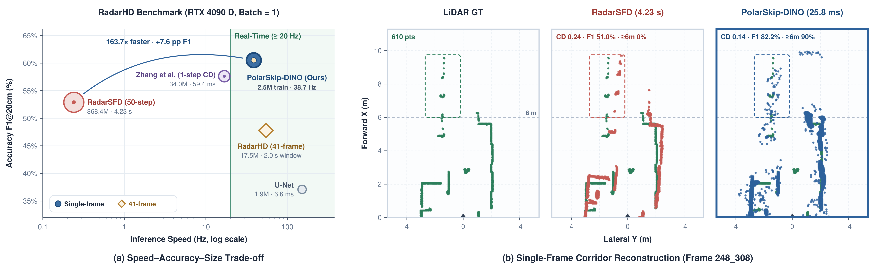
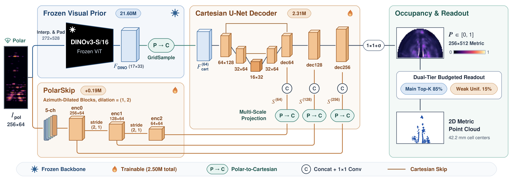
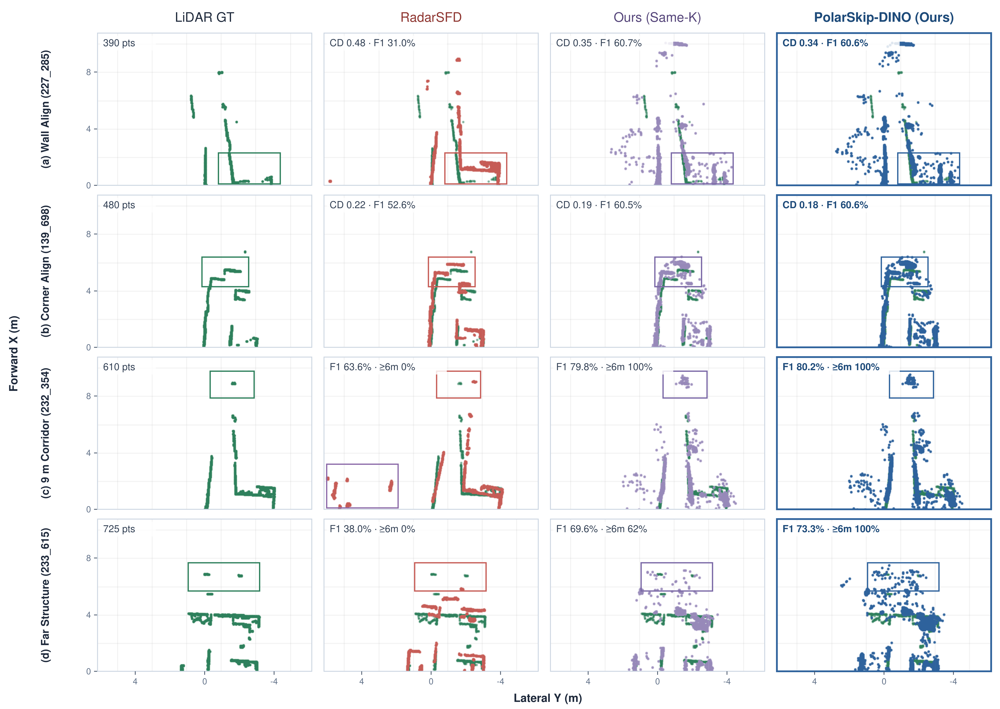
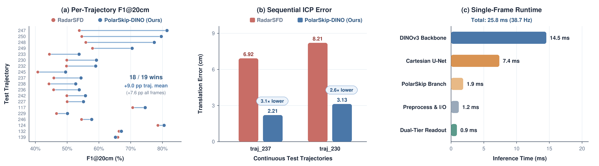
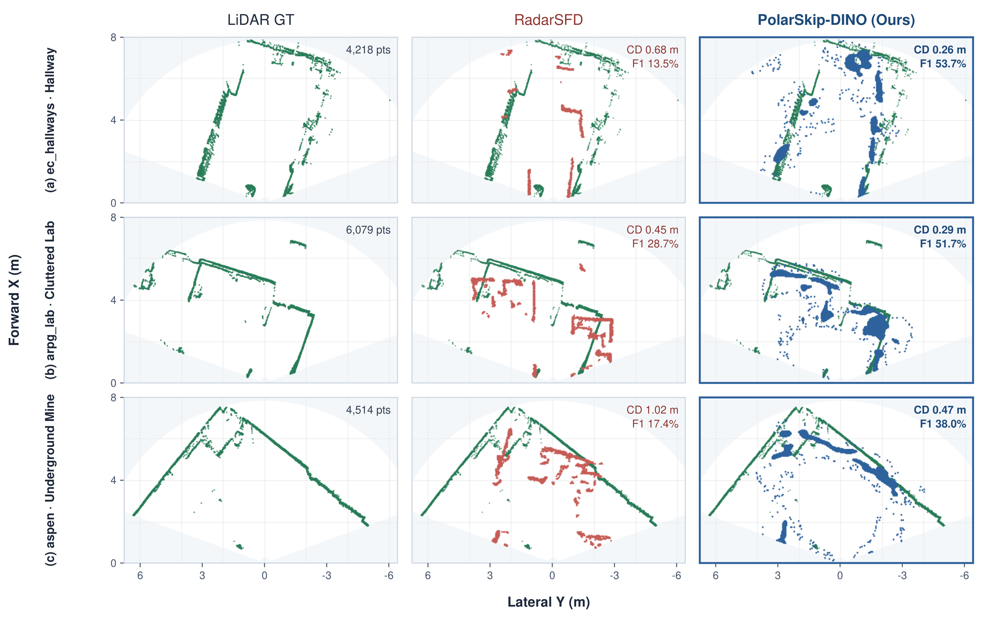

# PolarSkip-DINO

**Real-Time Single-Frame Millimeter-Wave Radar 2D Point Cloud Reconstruction via Visual Priors and Native Polar Echoes**

**English** | [简体中文](README_zh.md)



PolarSkip-DINO reconstructs dense, LiDAR-like 2D point clouds from a **single 77 GHz mmWave radar frame** at **38.7 Hz (`25.8 ms`, FP16)** on a single RTX 4090 D GPU with only **2.50M trainable parameters**.

### Highlights
- **Frozen Visual Backbone + Isotropic Cartesian Decoding**: Transfers a completely frozen **DINOv3-S/16** encoder into a lightweight metric Cartesian U-Net decoder, avoiding range-dependent polar convolutional distortion.
- **Lightweight PolarSkip Branch (`+0.19M` params)**: Preserves all 64 native azimuth bins with azimuth-dilated residual blocks (`dilation=(1, 2)`) to sharpen wall centerlines (`71.9 -> 64.0 mm`; `70.4 -> 61.5 mm` across 102,238 common-supported wall patches) and fine-tolerance alignment (`F1@5cm: 28.13% -> 29.50%`).
- **Training-Free Dual-Tier Readout (`<1 ms` CPU)**: Reserves a fixed deterministic uniform-sampling quota over the weak-support probability band to recover distant (`≥6 m`) wall segments and enable single-parameter density control (`d = 0.35 -> 0.25`) without retraining.
- **Real-Time & Compact**: Runs at **38.7 Hz** (`25.8 ms`) with **2.50M trainable parameters** (`24.10M` total, `63.08 GFLOPs`): **163.7× faster** than 50-step latent diffusion (`RadarSFD`) and **2.3× faster** than a 1-step consistency-distilled diffusion baseline (`Zhang et al. [26]`, `59.4 ms / 16.8 Hz`) with **13.6× fewer** trainable parameters.

---

## Architecture Overview



Frozen **DINOv3-S/16** and the trainable **PolarSkip** branch extract global structural context and native local echo cues in parallel from a single $256 \times 64$ polar heatmap. Both feature streams map analytically via inverse bilinear projection onto an isotropic metric Cartesian grid ($42.19\ \text{mm/cell}$), fuse across scales in a lightweight Cartesian U-Net decoder in one forward pass, and convert to a 2D metric point cloud via sub-millisecond dual-tier probability readout.

---

## Main Results

### 1. RadarHD Benchmark (`18,075` Held-Out Test Frames, 19 Trajectories, Excluding `configs/dev500_sids.json`)

| Method | History | Params (Total / Trainable) | `bs=1` GFLOPs ↓ | `bs=1` Latency (FPS) | CD (m) ↓ | F1@20 ↑ | F1@10 ↑ | F1@5 ↑ | ≥6m Recall ↑ | $c_{\mathrm{off}}$ (mm) ↓ | unsup ↓ |
|---|:---:|---:|---:|---:|---:|---:|---:|---:|---:|---:|---:|
| U-Net (Scratch) | 0 s | 1.93M / 1.93M | 36.88 | 6.6 ms (151.8 Hz) | 0.5938 | 37.10% | 25.67% | 16.26% | 9.58% | 68.9 | 59.6% |
| RadarHD (41-frame) | 2.0 s | 17.51M / 17.51M | 54.54 | 18.4 ms (54.3 Hz) | 0.4593 | 47.79% | 34.65% | 23.72% | 22.28% | 72.6 | 42.0% |
| RadarSFD (50-step, FP16) | 0 s | 868.37M / 865.92M | 18,755.73 | 4,228.8 ms (0.24 Hz) | 0.3552 | 52.90% | 38.22% | 25.50% | 21.82% | 80.5 | 36.1% |
| Zhang et al. [26] (1-step CD) | 0 s | 33.99M / 33.99M | 53.02 | 59.4 ms (16.8 Hz) | 0.3248 | 57.63% | 38.92% | 23.13% | **33.43%** | 74.1 | 31.3% |
| **PolarSkip-DINO (Full)** | 0 s | 24.10M / 2.50M | 63.08 | 25.8 ms (38.7 Hz) | **0.3000** | **60.52%** | **43.17%** | **29.50%** | 32.51% | **64.0** | **21.3%** |
| *RadarSFD (Same-K, 938 pts)* | *0 s* | *868.37M / 865.92M* | *18,755.73* | *4,228.8 ms* | *0.3553* | *52.89%* | *38.21%* | *25.48%* | *21.80%* | *80.5* | *36.2%* |
| ***PolarSkip-DINO (Same-K, 938 pts)*** | *0 s* | *24.10M / 2.50M* | *63.08* | *25.8 ms* | ***0.3120*** | ***58.95%*** | ***41.78%*** | ***28.27%*** | ***27.96%*** | ***64.7*** | ***24.2%*** |

*Notes:*
- *Accuracy reports 3-seed means evaluated against raw LiDAR GT-PCD (`60.52%` FP32 / `60.53%` FP16 `F1@20cm`, `0.3000 m` / `0.3001 m` CD, zero empty predictions). `eval_radarhd.py` evaluates a single specified checkpoint (e.g., `seed45`). Strict `Batch=1` FP16 latency is `25.8 ms` (`38.7 Hz`) with per-module sync and `25.4 ms` (`39.4 Hz`) end-to-end; Zhang et al. [26] is timed in its faster official FP32 mode (FP16: `71.0 ms`).*
- *Training-side held-out trajectory verification across all **18,575** official test frames (locking readout strictly on 3 held-out training trajectories): PolarSkip-DINO reaches **61.14% F1@20cm**, outperforms RadarSFD on all **19/19 trajectories**, and holds **60.40% vs. 52.86%** under Same-K.*
- *Downstream trajectories (`traj_237`, `traj_230`): reduces adjacent-frame ICP translation error by **2.6–3.1×** (`2.21–3.13 cm` vs. `6.92–8.21 cm`) and lifts reference-pose 2D occupancy grid mapping IoU up to **43.5%** vs. `36.4%`.*





### 2. Cross-Platform & Cross-Scene Generalization on ColoRadar (`300` Unseen Frames Across 3 Environments)

| Protocol | Method | `ec_hallways` | `arpg_lab` | `aspen` | Mean CD ↓ | Mean F1@20 ↑ | Mean F1@30 ↑ | ≥5m Recall ↑ | Capped F1@20 ↑ |
|---|---|---:|---:|---:|---:|---:|---:|---:|---:|
| Raw Sensor Reference | Raw Radar | 39.28% | 48.75% | 43.14% | 0.4873 | 43.73% | 52.86% | 53.58% | — |
| Zero-Shot Transfer | RadarSFD | 23.97% | 31.83% | 17.12% | 0.7735 | 24.31% | 32.92% | 6.84% | 24.31% |
| Zero-Shot Transfer | **PolarSkip-DINO** | **35.64%** | **47.71%** | **26.18%** | **0.5824** | **36.51%** | **46.68%** | **19.08%** | **32.87%** |
| 3-Fold LOBO Fine-Tuning | U-Net (Scratch, 2000 st) | 42.16% | 42.94% | 43.24% | 0.5701 | 42.78% | 52.25% | 13.23% | 41.35% |
| 3-Fold LOBO Fine-Tuning | **PolarSkip-DINO (4 min, 800 st)** | **49.08%** | **55.71%** | **44.86%** | **0.5367** | **49.88%** | **58.63%** | **19.49%** | **47.13%** |



---

## Repository Structure

```text
PolarSkip-DINO/
├── README.md                 # English documentation
├── README_zh.md              # Simplified Chinese documentation
├── configs/
│   ├── radarhd.yaml          # RadarHD training & dual-tier readout config
│   ├── coloradar.yaml        # ColoRadar zero-shot & 3-fold LOBO config
│   └── dev500_sids.json      # 500 dev sample IDs excluded from the 18,075 test split
├── polarskip_dino/
│   ├── geometry.py           # Exact cell-center polar <-> Cartesian grids
│   ├── model.py              # Frozen DINOv3-S/16 + PolarSkip + Cartesian U-Net
│   ├── loss.py               # ROI-normalized WBCE + Soft-Dice loss
│   ├── readout.py            # Training-free continuous dual-tier budgeted readout
│   ├── dataset.py            # RadarHD dataset_5 loader & ColoRadar slice_mid2 helper
│   └── metrics.py            # CD, F1@20/10/5cm, and far-field recall
├── scripts/
│   ├── train.py              # Train PolarSkip-DINO (Full or Lite)
│   ├── eval_radarhd.py       # Evaluate on RadarHD test split
│   ├── infer_single.py       # Single-frame inference & BEV visualization
│   └── benchmark_latency.py  # Strict Batch=1 end-to-end latency profiler
├── checkpoints/              # Place downloaded .pth weights here (gitignored)
├── assets/                   # Publication figures
└── requirements.txt
```

---

## Installation

```bash
conda create -n polarskip python=3.11 -y
conda activate polarskip
pip install -r requirements.txt
```

Clone Meta's official [DINOv3](https://github.com/facebookresearch/dinov3) repository (or let `torch.hub` fetch it) and obtain the `dinov3_vits16_pretrain_lvd1689m-08c60483.pth` weights. See [`checkpoints/README.md`](checkpoints/README.md) for our lightweight `9.7 MB` decoder weights.

---

## Quick Start

### 1. Single-Frame Inference Demo
```bash
python scripts/infer_single.py \
  --radar-png /path/to/RadarHD/dataset_5/test/radar/R_232_354.png \
  --lidar-png /path/to/RadarHD/dataset_5/test/lidar/L_232_354.png \
  --checkpoint checkpoints/polarskip_dino_radarhd_seed45.pth \
  --dino-weights /path/to/dinov3_vits16_pretrain_lvd1689m-08c60483.pth \
  --dinov3-repo /path/to/dinov3 \
  --out-prefix outputs/demo_232_354
```
For **Compact Mode** (zero retraining, ~20.8% fewer points), pass `--budget-frac 0.25`.

### 2. Evaluate on RadarHD (`18,075` Test Frames)
```bash
python scripts/eval_radarhd.py \
  --config configs/radarhd.yaml \
  --data-root /path/to/RadarHD/dataset_5 \
  --dino-weights /path/to/dinov3_vits16_pretrain_lvd1689m-08c60483.pth \
  --dinov3-repo /path/to/dinov3 \
  --checkpoint checkpoints/polarskip_dino_radarhd_seed45.pth \
  --exclude-ids-json configs/dev500_sids.json \
  --precision fp16 \
  --output-json outputs/radarhd_eval.json
```

### 3. Train from Scratch (~40 min on a Single GPU)
```bash
python scripts/train.py \
  --config configs/radarhd.yaml \
  --data-root /path/to/RadarHD/dataset_5 \
  --dino-weights /path/to/dinov3_vits16_pretrain_lvd1689m-08c60483.pth \
  --dinov3-repo /path/to/dinov3 \
  --variant full \
  --seed 45
```

### 4. Benchmark Strict `Batch=1` Latency (FP16)
```bash
python scripts/benchmark_latency.py \
  --dino-weights /path/to/dinov3_vits16_pretrain_lvd1689m-08c60483.pth \
  --dinov3-repo /path/to/dinov3 \
  --checkpoint checkpoints/polarskip_dino_radarhd_seed45.pth \
  --radar-dir /path/to/RadarHD/dataset_5/test/radar \
  --precision fp16
```

---

## Datasets & Acknowledgements

- **RadarHD**: Download `dataset_5` from [akarsh-prabhakara/RadarHD](https://github.com/akarsh-prabhakara/RadarHD).
- **ColoRadar**: Download sequences and calibration files from [arpg.github.io/coloradar](https://arpg.github.io/coloradar/).
- Built upon frozen representations from [Meta DINOv3](https://github.com/facebookresearch/dinov3).

## Citation

```bibtex
@article{polarskip_dino_2026,
  title   = {PolarSkip-DINO: Real-Time Single-Frame Millimeter-Wave Radar 2D Point Cloud Reconstruction via Visual Priors and Native Polar Echoes},
  author  = {Author List},
  year    = {2026}
}
```
