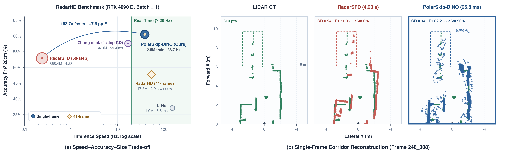
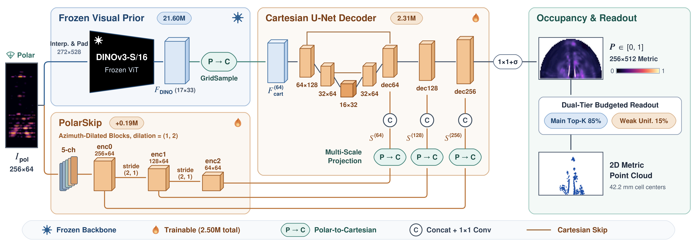
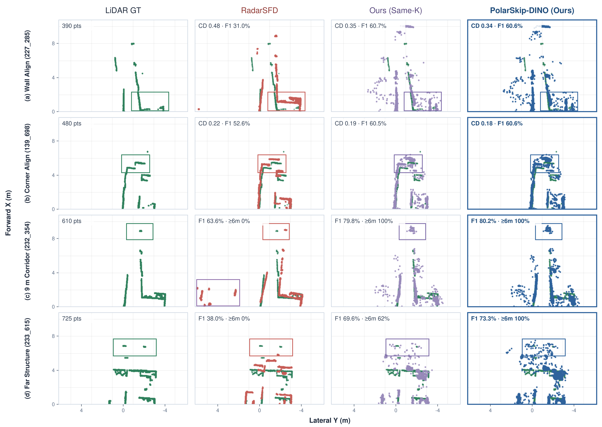
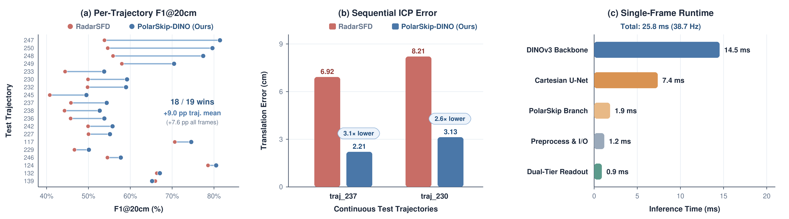
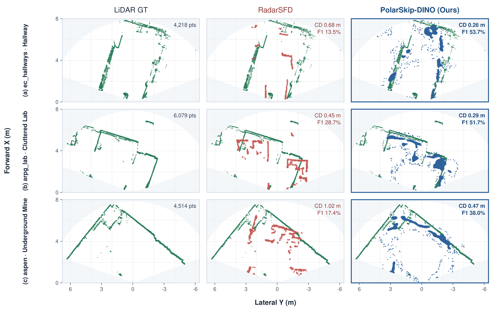

# PolarSkip-DINO

**融合视觉先验与原生极坐标回波的实时单帧毫米波雷达二维点云重建**

[English](README.md) | **简体中文**



PolarSkip-DINO 仅需**单帧 77 GHz 毫米波雷达极坐标热图**，即可在单张 RTX 4090 D 显卡上以 **38.7 Hz（`25.8 ms`，FP16）** 的实时速率重建稠密的类激光雷达二维点云，全网络可训练参数量仅为 **2.50M**。

### 核心亮点
- **冻结视觉主干 + 等比例笛卡尔解码**：将完全冻结的自监督视觉主干 **DINOv3-S/16** 特征解析映射至等比例米制笛卡尔网格（`42.19 mm/格`），由轻量 U-Net 解码器单步融合重建，避免极坐标横向尺度随距离畸变。
- **轻量极坐标空洞跳连分支 PolarSkip（`+0.19M` 参数）**：全程保留全部 64 个原生方位角采样，配合方位向空洞残差块（`dilation=(1, 2)`）精准收紧墙体中轴定位（全量墙段 `71.9 -> 64.0 mm`；102,238 个共同支持墙段 `70.4 -> 61.5 mm`），并提升高精容差对齐（`F1@5cm: 28.13% -> 29.50%`）。
- **免训练双档概率读出（CPU `<1 ms`）**：在弱支持概率带内预留固定比例的确定性均匀采样配额，有效找回 6 m 以上远场墙段，并支持通过单一密度参数（`d = 0.35 -> 0.25`）免重训切换高覆盖与紧凑输出模式。
- **实时且轻量**：总参数量 `24.10M`（可训练 `2.50M`）、`63.08 GFLOPs`、单帧 **`25.8 ms (38.7 Hz)`**，较 50 步潜空间扩散基线（`RadarSFD`）提速 **163.7 倍**、计算量压至 **1/297**，较单步一致性蒸馏扩散基线（`Zhang 等人 [26]`，`59.4 ms / 16.8 Hz`）提速 **2.3 倍** 且可训练参数仅为 **1/13.6**。

---

## 网络架构总览



冻结的 **DINOv3-S/16** 与可训练的 **PolarSkip** 分支并行处理单帧 $256 \times 64$ 极坐标雷达热图，分别提取全局空间结构特征与原生局部回波线索；两路特征经精确逆向双线性映射投影至等比例米制笛卡尔平面，在轻量 U-Net 解码器中多尺度融合并一次性输出连续占据概率图，最后经亚毫秒级 CPU 双档读出还原为二维米制点云。

---

## 主要实验结果

### 1. RadarHD 基准测试（`18,075` 留出测试帧，19 条轨迹，排除 `configs/dev500_sids.json`）

| 方法 | 历史窗口 | 参数量（总 / 可训） | `bs=1` GFLOPs ↓ | `bs=1` 延迟（帧率） | CD (m) ↓ | F1@20 ↑ | F1@10 ↑ | F1@5 ↑ | ≥6m 召回 ↑ | $c_{\mathrm{off}}$ (mm) ↓ | unsup ↓ |
|---|:---:|---:|---:|---:|---:|---:|---:|---:|---:|---:|---:|
| U-Net（从头训练） | 0 s | 1.93M / 1.93M | 36.88 | 6.6 ms (151.8 Hz) | 0.5938 | 37.10% | 25.67% | 16.26% | 9.58% | 68.9 | 59.6% |
| RadarHD（41 帧滑窗） | 2.0 s | 17.51M / 17.51M | 54.54 | 18.4 ms (54.3 Hz) | 0.4593 | 47.79% | 34.65% | 23.72% | 22.28% | 72.6 | 42.0% |
| RadarSFD（50 步，FP16） | 0 s | 868.37M / 865.92M | 18,755.73 | 4,228.8 ms (0.24 Hz) | 0.3552 | 52.90% | 38.22% | 25.50% | 21.82% | 80.5 | 36.1% |
| Zhang 等人 [26]（1 步 CD） | 0 s | 33.99M / 33.99M | 53.02 | 59.4 ms (16.8 Hz) | 0.3248 | 57.63% | 38.92% | 23.13% | **33.43%** | 74.1 | 31.3% |
| **PolarSkip-DINO（Full）** | 0 s | 24.10M / 2.50M | 63.08 | 25.8 ms (38.7 Hz) | **0.3000** | **60.52%** | **43.17%** | **29.50%** | 32.51% | **64.0** | **21.3%** |
| *RadarSFD（Same-K，938 点）* | *0 s* | *868.37M / 865.92M* | *18,755.73* | *4,228.8 ms* | *0.3553* | *52.89%* | *38.21%* | *25.48%* | *21.80%* | *80.5* | *36.2%* |
| ***PolarSkip-DINO（Same-K，938 点）*** | *0 s* | *24.10M / 2.50M* | *63.08* | *25.8 ms* | ***0.3120*** | ***58.95%*** | ***41.78%*** | ***28.27%*** | ***27.96%*** | ***64.7*** | ***24.2%*** |

*说明：*
- *表中精度为原始 LiDAR GT-PCD 口径下的 3 种子均值（FP32 `60.52%` / FP16 `60.53%` F1@20cm，CD `0.3000 m` / `0.3001 m`，全集零空帧预测）；`eval_radarhd.py` 针对单个指定权重文件（如 `seed45`）评估。严格 `Batch=1` FP16 逐模块同步耗时为 `25.8 ms`（`38.7 Hz`），端到端单次同步为 `25.4 ms`（`39.4 Hz`）；Zhang 等人 [26] 汇报其更快的官方 FP32 实测耗时（FP16 为 `71.0 ms`）。*
- *训练侧整轨留出验证（仅从官方 25 条训练轨迹中完整留出 3 条轨迹锁定读出参数，并在全部 **18,575** 帧官方测试集上评测）：PolarSkip-DINO 达到 **61.14% F1@20cm**（CD `0.3077 m`，**19/19 条测试轨迹全胜 RadarSFD**，Wilcoxon $p = 3.81 \times 10^{-6}$），Same-K 保持 **60.40% 对 52.86%**（**18/19 条轨迹领先**）。*
- *下游连续轨迹（`traj_237`、`traj_230`）：相邻帧 ICP 平移误差缩小 **2.6–3.1 倍**（`2.21–3.13 cm` 对 `6.92–8.21 cm`），参考位姿二维占据栅格建图 IoU 最高提升至 **43.5%**（RadarSFD 为 `36.4%`）。*





### 2. ColoRadar 跨平台与跨场景泛化（3 处未见场景共 `300` 帧）

| 评测协议 | 方法 | `ec_hallways` | `arpg_lab` | `aspen` | 均值 CD ↓ | 均值 F1@20 ↑ | 均值 F1@30 ↑ | ≥5m 召回 ↑ | 限点 F1@20 ↑ |
|---|---|---:|---:|---:|---:|---:|---:|---:|---:|
| 原始观测参考 | Raw Radar | 39.28% | 48.75% | 43.14% | 0.4873 | 43.73% | 52.86% | 53.58% | — |
| 零样本迁移 | RadarSFD | 23.97% | 31.83% | 17.12% | 0.7735 | 24.31% | 32.92% | 6.84% | 24.31% |
| 零样本迁移 | **PolarSkip-DINO** | **35.64%** | **47.71%** | **26.18%** | **0.5824** | **36.51%** | **46.68%** | **19.08%** | **32.87%** |
| 三折留一微调（LOBO） | U-Net（从头训练，2000 步） | 42.16% | 42.94% | 43.24% | 0.5701 | 42.78% | 52.25% | 13.23% | 41.35% |
| 三折留一微调（LOBO） | **PolarSkip-DINO（4 分钟，800 步）** | **49.08%** | **55.71%** | **44.86%** | **0.5367** | **49.88%** | **58.63%** | **19.49%** | **47.13%** |



---

## 仓库目录结构

```text
PolarSkip-DINO/
├── README.md                 # 英文说明文档
├── README_zh.md              # 简体中文说明文档
├── configs/
│   ├── radarhd.yaml          # RadarHD 训练与双档读出配置
│   ├── coloradar.yaml        # ColoRadar 零样本与三折留一微调配置
│   └── dev500_sids.json      # 18,075 留出测试集排除的 500 帧开发集 ID
├── polarskip_dino/
│   ├── geometry.py           # 精确栅格中心极坐标 <-> 笛卡尔投影网格
│   ├── model.py              # 冻结 DINOv3-S/16 + PolarSkip + 笛卡尔 U-Net
│   ├── loss.py               # ROI 归一化加权 BCE + Soft-Dice 联合损失
│   ├── readout.py            # 免训练连续浮点双档概率读出
│   ├── dataset.py            # RadarHD dataset_5 加载与 ColoRadar 水平切片辅助
│   └── metrics.py            # CD、F1@20/10/5cm 与远场召回评价指标
├── scripts/
│   ├── train.py              # 训练 PolarSkip-DINO（Full 或 Lite）
│   ├── eval_radarhd.py       # RadarHD 测试集统一评估脚本
│   ├── infer_single.py       # 单帧推理与鸟瞰图可视化示例
│   └── benchmark_latency.py  # 严格 Batch=1 端到端时延基准测试
├── checkpoints/              # 存放下载的 .pth 权重文件（已 gitignore）
├── assets/                   # 论文主图资源
└── requirements.txt
```

---

## 环境安装

```bash
conda create -n polarskip python=3.11 -y
conda activate polarskip
pip install -r requirements.txt
```

请克隆 Meta 官方 [DINOv3](https://github.com/facebookresearch/dinov3) 仓库（或通过 `torch.hub` 自动拉取）并准备 `dinov3_vits16_pretrain_lvd1689m-08c60483.pth` 预训练权重。本模型仅需约 `9.7 MB` 的解码器与 PolarSkip 权重，存放方式见 [`checkpoints/README.md`](checkpoints/README.md)。

---

## 快速开始

### 1. 单帧推理示例
```bash
python scripts/infer_single.py \
  --radar-png /path/to/RadarHD/dataset_5/test/radar/R_232_354.png \
  --lidar-png /path/to/RadarHD/dataset_5/test/lidar/L_232_354.png \
  --checkpoint checkpoints/polarskip_dino_radarhd_seed45.pth \
  --dino-weights /path/to/dinov3_vits16_pretrain_lvd1689m-08c60483.pth \
  --dinov3-repo /path/to/dinov3 \
  --out-prefix outputs/demo_232_354
```
如需切换至**紧凑模式**（免重训，输出点数减少约 20.8%），附加参数 `--budget-frac 0.25` 即可。

### 2. 在 RadarHD 测试集上评估（`18,075` 帧）
```bash
python scripts/eval_radarhd.py \
  --config configs/radarhd.yaml \
  --data-root /path/to/RadarHD/dataset_5 \
  --dino-weights /path/to/dinov3_vits16_pretrain_lvd1689m-08c60483.pth \
  --dinov3-repo /path/to/dinov3 \
  --checkpoint checkpoints/polarskip_dino_radarhd_seed45.pth \
  --exclude-ids-json configs/dev500_sids.json \
  --precision fp16 \
  --output-json outputs/radarhd_eval.json
```

### 3. 从头训练（单卡约 40 分钟）
```bash
python scripts/train.py \
  --config configs/radarhd.yaml \
  --data-root /path/to/RadarHD/dataset_5 \
  --dino-weights /path/to/dinov3_vits16_pretrain_lvd1689m-08c60483.pth \
  --dinov3-repo /path/to/dinov3 \
  --variant full \
  --seed 45
```

### 4. 严格 `Batch=1` 推理时延基准测试（FP16）
```bash
python scripts/benchmark_latency.py \
  --dino-weights /path/to/dinov3_vits16_pretrain_lvd1689m-08c60483.pth \
  --dinov3-repo /path/to/dinov3 \
  --checkpoint checkpoints/polarskip_dino_radarhd_seed45.pth \
  --radar-dir /path/to/RadarHD/dataset_5/test/radar \
  --precision fp16
```

---

## 数据集与致谢

- **RadarHD**：从 [akarsh-prabhakara/RadarHD](https://github.com/akarsh-prabhakara/RadarHD) 下载 `dataset_5`。
- **ColoRadar**：从 [arpg.github.io/coloradar](https://arpg.github.io/coloradar/) 下载序列与标定文件。
- 本项目基于 [Meta DINOv3](https://github.com/facebookresearch/dinov3) 的冻结自监督视觉表征构建。

## 引用

```bibtex
@article{polarskip_dino_2026,
  title   = {PolarSkip-DINO: Real-Time Single-Frame Millimeter-Wave Radar 2D Point Cloud Reconstruction via Visual Priors and Native Polar Echoes},
  author  = {Author List},
  year    = {2026}
}
```
